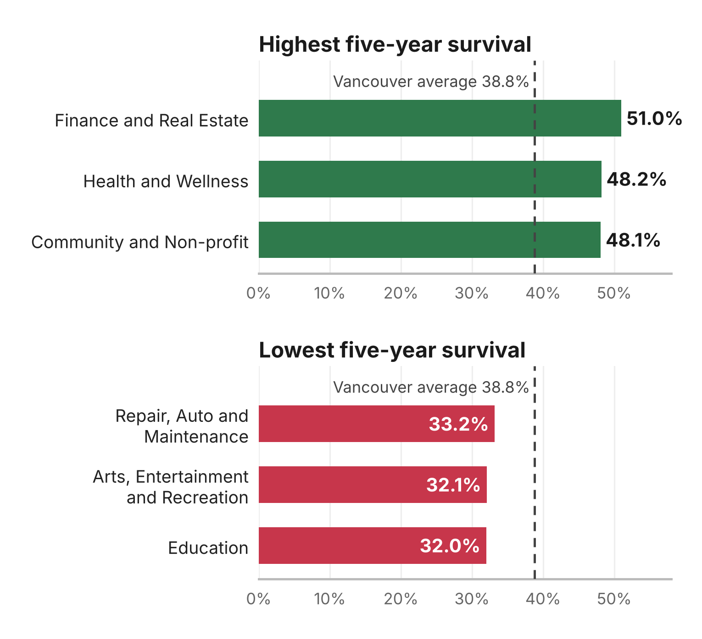
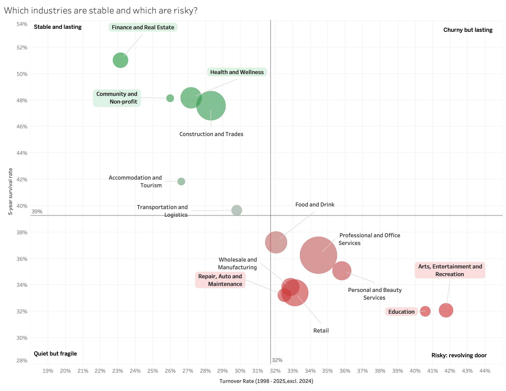
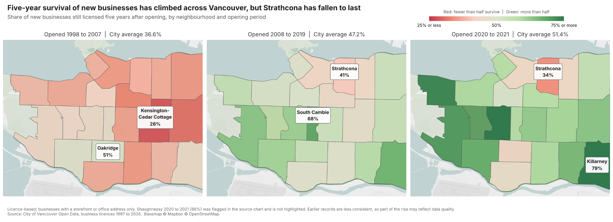

# Where Should You Start a Business in Vancouver?

**A Tableau study of business survival, turnover and neighbourhoods using City of Vancouver licence records.**

A UBC Master of Business Analytics team project designed to help prospective owners explore what kind of business to open and where. The analysis covers multiple industries, including Food and Drink, rather than restaurants alone.

**Tools:** Tableau · data visualization · calculated fields · geographic analysis · data storytelling

[Read the team report](Vancouver_Business_Survival_Report.pdf) · [View my Tableau source](Lan_Part2_Survival_by_Category.twb) · [Data setup](DATA_SETUP.md)

*Figure reproduced from the final team report. The report combined the original two bar charts into this presentation figure without changing values.*

## My contribution — Lan Lan

- Designed and built the Part 2 Tableau visualization comparing five-year business survival across categories.
- Developed the visual presentation of the category comparison using the citywide benchmark to support interpretation.
- Presented and explained this section in the team's final presentation.

The complete analysis, data preparation and other charts were collaborative team work. The additional figures below provide project context; they are not presented as my individual work.

## Questions explored by the team

1. How volatile is Vancouver's business scene?
2. Which categories have the highest and lowest five-year survival?
3. How are turnover and survival associated?
4. How does survival vary across neighbourhoods and opening periods?
5. Where have businesses in a selected industry historically lasted?

## Selected findings from the final report

| Measure | Reported result |
| --- | --- |
| Raw licence records | Approximately 1.95 million |
| Constructed business locations | 273,365 |
| Overall five-year survival | 38.8% |
| Finance and Real Estate | 51.0% five-year survival |
| Health and Wellness | 48.2% five-year survival |
| Education | 32.0% five-year survival |

These are results reported by the team for its historical snapshot, not independently rerun figures for this portfolio release. Five-year survival covers businesses first observed in 1998-2021; residential rentals are excluded, and the category chart requires at least 500 eligible businesses.

## Team project views

## Methods and interpretation

The team's preparation linked licence renewals into business locations using standardized names and addresses, reconciled overlapping records and grouped changing business classifications. The Tableau views use category comparisons, reference lines and neighbourhood maps.

A business remaining licensed is not the same as profitability. Moves and name changes can appear as closures and openings; policy changes affect some years; maps exclude records without usable locations. Results describe historical associations and do not predict whether a particular new business will succeed.

## Files and viewing

- `Vancouver_Business_Survival_Report.pdf`: full final team report and all five chart explanations.
- `Lan_Part2_Survival_by_Category.twb`: my Part 2 worksheet source; data reconnection is required.
- PNG files: report figures for quick viewing without Tableau.
- `DATA_SETUP.md`: source information and workbook limitations.

The source workbook contains one worksheet, not a standalone web dashboard. Prepared datasets are not bundled. See [DATA_SETUP.md](DATA_SETUP.md) before attempting to open it interactively.

## Team and attribution

**Group 5:** Lan Lan, Landy Feng, Liam Hart, Shallovern Srodah, Vertika Chaudhary and Taylor Wei. UBC Sauder School of Business, BAIT 518 Data Visualization, October 2026.

**Data:** City of Vancouver Open Data Portal, Business Licences and Local Area Boundary datasets. See the [source and setup notes](DATA_SETUP.md) and report references.

**AI assistance:** The team report discloses Claude assistance with cleaning code, Tableau setup, chart refinements, annotations and report assembly. The team set the research questions, analysis and conclusions. This portfolio packaging preserves that attribution.
